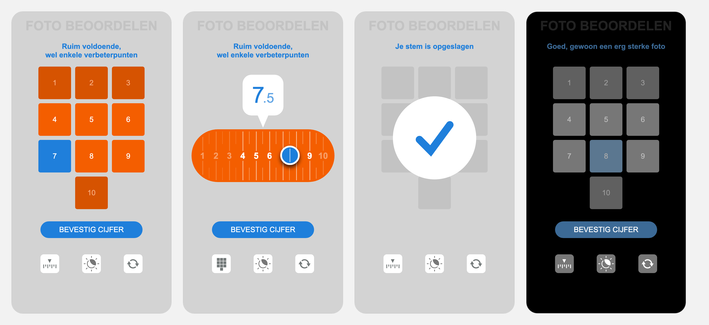
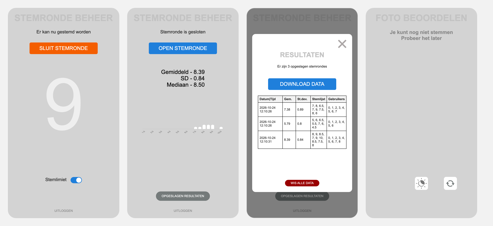

# VoteApp

Voting app for photo club evenings. During a review, members score each photo from 1 to 10 on their own phone, and the club gets the average score straight away. No app to install: members open a web page.

- Voting page: `https://yourclub.synology.me` (example address)
- Admin page: `https://yourclub.synology.me/admin` (protected by a code)

## How it works

1. The admin opens a round on the admin page when a photo is shown.
2. Every open voting page switches to the keypad within a second or so. Members pick a score with the keypad (whole numbers) or the slider (half points) and confirm. A short text explains each score (e.g. 7 = "Ruim voldoende, wel enkele verbeterpunten").
3. The admin sees the number of votes come in live, and closes the round. The page then shows the average, standard deviation, median and a chart of the scores.
4. Every closed round is saved, and the full history can be downloaded as a CSV file for Excel.

With the vote limit (*Stemlimiet*) switched on, each phone can vote once per round. A dark mode keeps phone screens from lighting up the room while photos are shown.

## Anonymous voting

- Members never enter a name or log in.
- On the first visit, the voting page creates a random ID on the phone itself. The server only uses it to recognise a phone within a round (for the vote limit), and replaces it with a plain number (0, 1, 2, …) in the results.
- The results therefore show *that* voter 3 gave a 7, never *who* voter 3 is.
- The ID doesn't last long: Safari removes it after a week without visiting the page, so a phone usually gets a new ID, and a new number, at the next club evening. A private browser window or another browser also gives a new ID. The admin can reset all numbers with *Wis alle data*.

## Screens

Voting page: keypad, slider, vote received, dark mode.

Admin page: round open with the live vote count, round closed with the results, stored rounds, and the voting page between rounds.

## Technology

Built with Python and Flask, with plain HTML, CSS and JavaScript pages. Runs on a Synology NAS behind its HTTPS reverse proxy (the app itself listens on port 8080). See `Instructions/` for setup, starting, stopping and updating.

## Licence

MIT, see [LICENSE](LICENSE).
